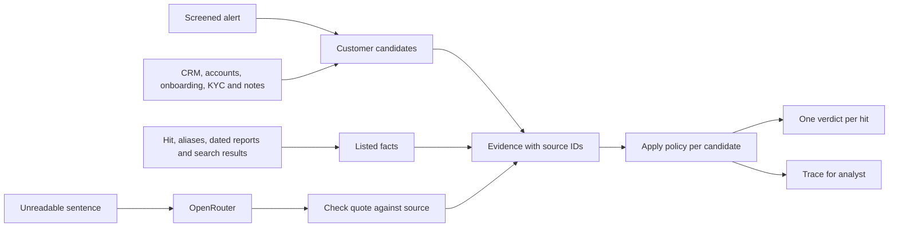

# ALIBI

ALIBI resolves a screened customer against each watchlist hit and records the facts behind the decision. The analyst queue opens on hits requiring review. An alert stays open while any hit requires review or identifies the customer.

## Run

From the repository root, with Python 3.9+ and a POSIX shell:

```sh
system/run system/example output/example.jsonl
python3 -S -m alibi.reproduce system/example output/example.jsonl
python3 -S -m alibi.casefile output/example.jsonl
```

Open http://127.0.0.1:8765/ for the analyst view. The first command runs the three synthetic cases below. The second executes the actual runner five times and adds the results to the trace. The third serves the local output. Use J/K to move between hits, E for the evidence and rule path, and T for the individual runs. Analyst actions are stored in the current browser.

For judging, replace the example directory with the supplied JSONL directory. Set `OPENROUTER_API_KEY` in the environment to enable sentence extraction. Running with an empty key is supported. The runner reads the input tables without consulting the practice labels and uses Python's standard library. Each execution uses a fresh temporary model cache.

```sh
system/run screening/dev output/dev.jsonl
python3 -S screening/validate.py --data screening/dev --output output/dev.jsonl --score screening/dev/practice_labels.jsonl
```

The second command uses the validator from the participant data room. Run the five-run harness against the same input to regenerate a trace with all five observations. The published verdict file is sufficient for judging. Generate the trace locally to view the evidence in the analyst interface.

## How a hit is decided



**Customer.** Follow the account, login or email link. When several people share the link, filter using screened details. Without a link, compare names, birth date, country and city. Merge records transitively through a shared phone plus full DOB or the same approved document number. Use the latest approved provider check or onboarding note for verified identity. If several people remain, compare the hit against each and refer divergent decisions.

**Listed entity.** Compare names and aliases using the supplied variants, legal forms, edit limits and joined or split name parts. Read structured dates, then the first profile paragraph. A stated age at an event yields two possible birth years. A search result qualifies only when its listing description and country tie it to the hit. Compare the earliest qualifying report with the customer's age or incorporation date. The rules check date, country, verified name, entity type and death before screening. A confirming person match needs name and birth date agreement. Companies require name and country agreement. Contradictions prevent confirmation.

**Evidence.** Each usable fact retains its source record ID. A submitted row contains the hit and alert IDs, resolved customer ID, decision, reason code, explanation and decisive evidence IDs. The adjacent `.trace.jsonl` stores candidate comparisons, rule outcomes, rejected web evidence and model quotes or failure statuses. Five-run traces also include one decision and code per process.

## Model, time and reproducibility

The default route is `openrouter/free`. OpenRouter selects the upstream model. To pin a specific endpoint set `ALIBI_MODEL`. The exact prompt lives in `alibi/extract.py`. It asks for verbatim legal name, DOB, age or event year and a supporting quote for each. The client sends one unresolved sentence per request at temperature 0 and seed 1. It rejects unsupported JSON fields and unverified spans. A truncated completion gets one retry with the output budget increased from 2,048 to 4,096 tokens. Missing credentials, invalid responses and unavailable providers leave dependent hits for review. An independent contradiction can still settle the hit.

Requests are deduplicated by sentence and processed by up to eight workers. The private cache key includes the text hash, route and seed. Sorted output, explicit rule precedence and `PYTHONHASHSEED=0` stabilize local decisions. Free-route selection and provider availability can vary between cold runs. The harness records disagreements and returns the affected hit for review.

The organizers' JSONL development set produced 819 hits. Five empty-key runs took 2.5–2.8 seconds each on the development Mac, cost $0 in API calls, and produced byte-identical verdict files. The official validator reported zero problems. On 50 labeled hits, decisions, reason codes and customer records were all correct, with zero unsafe clearances and 108 of 108 cost points saved. These measurements cover the empty-key configuration. Live requests have a shared 25-minute extraction deadline. The default route uses free inference.

## Worked cases

All three synthetic hits in `system/example` belong to alert `A-DEMO`. Its email resolves to `C-DEMO`, whose approved check `K-DEMO` identifies Mira Arden, born 10 June 1990.

| Hit | Evidence and outcome |
| --- | --- |
| H-01 | The listed birth year is 1960. The verified 1990 date contradicts it. Clear as DIFFERENT_ENTITY with DOB_MISMATCH, citing H-01 and K-DEMO. |
| H-02 | The listed name, birth year 1990 and UK country agree. Confirm SAME_ENTITY with NAME_DOB_LOCATION_MATCH, citing C-DEMO, H-02 and K-DEMO. |
| H-03 | The listed name agrees, but the profile supplies no birth date. Refer as REVIEW with INSUFFICIENT_DATA, citing H-03 and K-DEMO. |

The alert remains open with one of three hits cleared. [Download the captioned demo (MP4)](https://github.com/ronitbhatia/alibi-screening/raw/refs/heads/main/system/demo.mp4).
